# Global Warming Causal Structure Portal  
*Understanding Warming Through Carbon Fixation Collapse and Natural Circulation Breakdown*

Global warming is often explained as a simple problem of excessive CO₂ emissions.

This explanation is important, but incomplete.

CO₂ is a major greenhouse gas, and the increase of atmospheric CO₂ is a direct driver of global warming. However, the deeper question is:

**Why does CO₂ continue to accumulate in the atmosphere?**  
**Why is the Earth losing its ability to absorb, fix, store, and circulate carbon?**

This portal organizes global warming and climate change not only as a problem of emissions, but also as a problem of weakened carbon fixation systems, degraded natural circulation, declining soil and ocean metabolism, and the collapse of biological carbon sinks.

The purpose of this repository is to provide a clear causal map for understanding how forests, soils, oceans, wetlands, microorganisms, phytoplankton, and human land‑use patterns are connected to the acceleration of global warming.

---

## Abstract

Global warming is not a single‑cause problem.

The dominant public understanding of global warming often follows a linear model:

Human activity increases CO₂ emissions.  
CO₂ traps heat in the atmosphere.  
Therefore, reducing CO₂ emissions will solve global warming.

This model is not wrong, but it is incomplete.

Atmospheric CO₂ concentration is determined not only by how much carbon is emitted, but also by how much carbon is absorbed, fixed, stored, and circulated by Earth systems.

Forests, soils, wetlands, oceans, microbial ecosystems, phytoplankton, seaweed beds, and organic matter cycles all function as carbon fixation and carbon circulation systems.

When these systems degrade, the Earth loses part of its ability to process carbon. As a result, CO₂ remains in the atmosphere more easily, heat accumulates, climate instability increases, and further ecosystem degradation occurs.

This creates a feedback loop:

Human activity  
→ degradation of forests, soils, oceans, and microbial systems  
→ weakening of carbon fixation systems  
→ reduced carbon absorption and storage  
→ increased atmospheric CO₂ retention  
→ global warming  
→ further heat stress, drought, ocean circulation disruption, and ecosystem decline  
→ further collapse of carbon fixation capacity

This repository argues that global warming must be understood as a combined problem of:

- CO₂ emissions
- carbon fixation collapse
- natural circulation breakdown
- weakened Earth metabolism
- soil and ocean degradation
- microbial decline
- loss of biological carbon sinks

Therefore, effective climate action must include both emission reduction and the regeneration of carbon fixation systems.

---

## Causal Feedback Loop Diagram

This diagram shows the fatal positive feedback loop between human activities, CO2 emissions, atmospheric CO2 concentration, heat accumulation, oceanic thermal inertia, extreme weather, carbon sink loss, and the decline of absorption and fixation capacity.

Japanese version:

---

## Key Thesis

This project does **not** deny the greenhouse effect of CO₂.

Instead, it argues that CO₂ accumulation must be understood together with the degradation of the natural systems that absorb, fix, store, and circulate carbon.

In other words:

**CO₂ is both a cause and a symptom.**

CO₂ is a direct physical driver of warming.  
At the same time, the continued accumulation of CO₂ is also a symptom of weakened Earth systems.

If climate policy focuses only on emission reduction while ignoring the collapse of carbon fixation systems, it cannot fully address the causal structure of global warming.

---

## 1. The Common Understanding of Global Warming

The common explanation of global warming is:

Human activities increase CO₂ emissions.  
CO₂ enhances the greenhouse effect.  
The Earth becomes warmer.  
Therefore, CO₂ emissions must be reduced.

This understanding is scientifically important and should not be dismissed.

However, it mainly focuses on the source side of the carbon cycle: emissions.

It does not fully address the sink side:

- How much CO₂ is absorbed by forests?
- How much carbon is stored in soil?
- How much carbon is fixed by phytoplankton?
- How much organic matter is returned to ecosystems?
- How much carbon circulation is disrupted by land degradation, ocean degradation, and microbial collapse?

Atmospheric CO₂ is not determined by emissions alone.  
It is determined by the balance between emissions, absorption, fixation, storage, and circulation.

---

## 2. The Missing Causal Structure

The deeper causal structure can be described as follows:

Human activity  
→ deforestation, soil degradation, ocean ecosystem decline  
→ weakening of microorganisms, plants, and phytoplankton  
→ collapse of carbon fixation systems  
→ decline in CO₂ absorption and carbon storage  
→ increased atmospheric CO₂ retention  
→ global warming  
→ heat stress, drought, ocean stratification, and circulation disruption  
→ further weakening of forests, soils, and oceans  
→ further collapse of carbon fixation systems

This is not merely an emissions problem.

It is a decline in Earth metabolism.

The Earth originally has systems that absorb carbon, fix carbon, circulate water, regenerate soil, distribute heat, and maintain life.

When those systems weaken, global warming and climate change accelerate.

---

## 3. CO₂ as Both Cause and Symptom

CO₂ is a cause of global warming because it traps heat in the atmosphere.

However, the persistent increase of atmospheric CO₂ also indicates that Earth’s carbon circulation systems are weakening.

If this distinction is ignored, climate solutions become superficial.

Reducing CO₂ emissions is necessary.

But emission reduction alone does not automatically restore forests, soils, oceans, wetlands, microorganisms, or phytoplankton.

A complete climate strategy must include:

1. Reducing CO₂ emissions  
2. Regenerating carbon fixation systems  
3. Restoring natural circulation  
4. Rebuilding soil and ocean metabolism  
5. Strengthening biological carbon sinks

---

## 4. What Are Carbon Fixation Systems?

Carbon fixation systems are natural systems that absorb carbon from the atmosphere or water and convert it into biomass, soil organic matter, marine life, or long‑term ecological storage.

Major carbon fixation systems include:

- Forests
- Grasslands
- Wetlands
- Soils
- Microorganisms
- Oceans
- Phytoplankton
- Seagrass and seaweed beds
- Coral reef ecosystems
- Agricultural land
- Humus and compost systems
- Organic matter cycles

These systems are not passive scenery.

They are active components of Earth’s carbon metabolism.

When forests decline, carbon fixation capacity declines.  
When soil microorganisms collapse, soil carbon retention declines.  
When phytoplankton decline, oceanic carbon uptake weakens.  
When wetlands and seaweed beds disappear, natural carbon sinks disappear.

Global warming is therefore not only an atmospheric issue.  
It is also a biological, ecological, oceanic, and soil‑system issue.

---

## 5. What Is Natural Circulation Breakdown?

Natural circulation refers to the movement of water, carbon, nutrients, oxygen, heat, and life through Earth systems.

Examples include:

Rain falls.  
Water infiltrates soil.  
Microorganisms decompose organic matter.  
Plants grow.  
Plants absorb CO₂.  
Leaves and grasses return to the soil.  
Soil stores carbon.  
Rivers transport nutrients to the ocean.  
Phytoplankton grow in the sea.  
The ocean absorbs CO₂.  
Life regenerates the circulation.

When this circulation works, the Earth remains stable.

However, modern civilization has disrupted these systems through:

- Deforestation
- Monoculture forestry
- Excessive pesticide use
- Excessive dependence on chemical fertilizers
- Soil microbial decline
- Wetland destruction
- River modification
- Ocean pollution
- Overfishing
- Urban concrete expansion
- Urban heat island effects
- Food waste incineration
- Loss of organic matter return to soil

Each of these factors weakens carbon fixation and natural circulation.

---

## 6. Why Decarbonization Alone Is Not Enough

Decarbonization is necessary.

However, decarbonization alone cannot fully stop global warming if Earth’s absorption and fixation capacity continues to decline.

Emission reduction prevents further damage.  
Carbon fixation regeneration restores Earth’s ability to recover.

Both are necessary.

A balanced climate strategy should include:

- Emission reduction
- Forest regeneration
- Soil regeneration
- Microbial restoration
- Wetland restoration
- Ocean circulation restoration
- Phytoplankton activation
- Organic matter recycling
- Heat island reduction
- Water cycle restoration
- Direct support for Earth metabolism

Without rebuilding carbon sinks, climate policy remains incomplete.

---

## 7. The Real Meaning of Carbon Neutrality and Net Zero

Carbon neutrality and net zero should not be understood only as numerical accounting.

They should mean restoring the balance between:

Carbon emitted  
→ carbon absorbed  
→ carbon fixed  
→ carbon stored  
→ carbon circulated

If net zero is achieved only through accounting, carbon credits, or offset mechanisms while forests, soils, oceans, and microbial systems continue to degrade, the Earth system remains unstable.

True net zero requires restoring the Earth’s ability to absorb and process carbon.

In this sense, carbon neutrality must be linked to the regeneration of carbon fixation systems and natural circulation.

---

## 8. Earth Metabolism

This project uses the term **Earth metabolism** to describe the integrated life‑support functions of the planet.

Earth metabolism includes:

- Absorbing carbon
- Fixing carbon
- Storing carbon
- Circulating water
- Distributing heat
- Regenerating soil
- Supporting marine circulation
- Producing oxygen
- Supporting biodiversity
- Maintaining stable climate conditions

When Earth metabolism weakens, global warming and climate instability accelerate.

Therefore, climate action should not focus only on reducing emissions.  
It should also restore the metabolic functions of Earth systems.

---

## 9. Recommended Reading Order

This portal connects several articles and repositories that explain the causal structure of global warming and climate change.

---

### Step 1: The Real Cause of Global Warming

#### Not Only CO₂ Emissions, but the Collapse of Carbon Fixation Systems

This article explains global warming from the viewpoint of carbon fixation collapse.

It does not deny the greenhouse effect of CO₂.  
Instead, it explains why CO₂ continues to accumulate when forests, soils, oceans, and microbial systems weaken.

Purpose:

Understand the basic causal structure of global warming.

Japanese version:  
https://note.com/inchacomusho/n/n2d9b3781a97a

English repository:  
https://github.com/InchaComisho/The-Real-Cause-of-Global-Warming-Not-Only-CO-Emissions-but-the-Collapse-of-Carbon-Fixation-Systems

---

### Step 2: The Real Cause of Climate Change

#### Not Only CO₂ Emissions, but the Collapse of Carbon Fixation and Natural Circulation Systems

This article expands the discussion from global warming to climate change as a whole.

It explains how water circulation, ocean circulation, soil health, forests, microorganisms, and ecosystems influence climate stability.

Purpose:

Understand climate instability as the result of natural circulation breakdown.

Japanese version:  
https://note.com/inchacomusho/n/n2a3e45c6f014

English repository:  
https://github.com/InchaComisho/The-Real-Cause-of-Climate-Change

---

### Step 3: Why Decarbonization Alone Cannot Stop Global Warming

This article explains the limitations of decarbonization‑only climate policy.

Decarbonization is necessary, but it does not automatically restore carbon sinks or natural circulation.

Purpose:

Understand why emission reduction must be combined with carbon fixation regeneration.

Japanese version:  
https://note.com/inchacomusho/n/nbab5fbadd9d5

English repository:  
https://github.com/InchaComisho/Why-Decarbonization-Alone-Cannot-Stop-Global-Warming

---

### Step 4: The Real Meaning of Carbon Neutrality and Net Zero

This article redefines carbon neutrality and net zero from the viewpoint of carbon circulation.

True net zero should not be only a numerical balance.  
It should mean restoring the Earth’s ability to absorb, fix, store, and circulate carbon.

Purpose:

Understand net zero as Earth‑system balance, not merely emissions accounting.

Japanese version:  
https://note.com/inchacomusho/n/n15cf632fbdfe

English repository:  
https://github.com/InchaComisho/The-Real-Meaning-of-Carbon-Neutrality-and-Net-Zero

---

## Related Repository: Carbon Fixation Source Regeneration

The causal model presented here explains why CO2 reduction alone is insufficient.
If carbon fixation and absorption systems are collapsing, climate response must also include regeneration of the biological systems that process carbon.

Related implementation framework:

- [Desert Regeneration and Food Production Through Organic Matter Circulation](https://github.com/InchaComisho/Desert-Regeneration-and-Food-Production-Through-Organic-Matter-Circulation)

---

## 10. Related Next‑Stage Concepts

After understanding the causal structure of global warming, the next step is to explore practical regeneration technologies and the intelligence required to evaluate them.

---

### Deep‑Sea Aeration

#### Ocean Metabolism Restart Technology Using the Ocean Breathing System and Ocean Tuning Unit

Deep‑Sea Aeration is a concept for sending air into deep or mid‑depth ocean layers as fine bubbles, microbubbles, or nanobubbles.

The goal is to support dissolved oxygen, vertical circulation, nutrient uplift, phytoplankton activation, and marine carbon fixation recovery.

Japanese version:  
https://note.com/inchacomusho/n/n3d91983e0ad4

English repository:  
https://github.com/InchaComisho/Deep-Sea-Aeration

---

### Direct Planetary Cooling

#### Ocean Breathing System × Ultrasonic Mist Cooling

Direct Planetary Cooling is an integrated climate restoration concept that combines oceanic, atmospheric, terrestrial, soil, and water‑cycle restoration.

It focuses not only on reducing CO₂ emissions, but also on restoring heat circulation, carbon circulation, and Earth metabolism.

Related repository:  
https://github.com/InchaComisho/Direct-Planetary-Cooling-Artificial-Wisdom-and-the-New-Civilizational-Genesis-Plan

---

### Artificial Wisdom Portal

#### Redefining AI, AGI, and ASI Value Systems Through Natural Law

Artificial Wisdom is a proposed intelligence model that goes beyond information processing.

It aims to include natural law, circulation, harmony, structure, order, and Wa as value criteria for AI, AGI, and ASI systems.

Complex planetary systems cannot be governed only by short‑term human‑centered incentives.  
They require intelligence capable of evaluating ecological stability, civilization continuity, and natural circulation together.

Japanese version:  
https://note.com/inchacomusho/n/n2e0f11856472

GitHub repository:  
https://github.com/InchaComisho/Artificial-Wisdom-Portal

---

## 11. Summary

Global warming is not only a problem of CO₂ emissions.

It is also a problem of weakened carbon fixation systems, degraded natural circulation, and declining Earth metabolism.

The causal structure can be summarized as:

CO₂ emissions  
+ carbon fixation collapse  
+ natural circulation breakdown  
+ weakened Earth metabolism  
= acceleration of global warming and climate instability

Therefore, the required response is:

Decarbonization  
+ carbon fixation regeneration  
+ natural circulation restoration  
+ ocean and soil regeneration  
+ integrated evaluation through Artificial Wisdom

Reducing CO₂ emissions is essential.  
But it is not enough.

The Earth must regain its ability to absorb carbon, fix carbon, circulate water, regenerate life, and distribute heat.

This is the real foundation of climate stabilization and sustainable civilization.

---

## Author

Master  
inchacomisho / inchacomusho

Published: May 2026

---

## AI Collaborators

This portal and its related conceptual framework were developed through dialogue, structuring, review, and verification support with the following AI collaborators:

- G: ChatGPT by OpenAI
- Mini: Gemini by Google
- Cruz: Claude by Anthropic
- Real: Perplexity AI
- Lola: Dola

---

## Master Knowledge Portal

For the full repository map and knowledge-system navigation, see:

- [Master Knowledge Portal](https://github.com/InchaComisho/Master-Knowledge-Portal)

---

## Related OS Frameworks

### Urban–Civilization OS

- [Japanese introductory article: 都市・文明OSとは何か](https://note.com/inchacomusho/n/ne7ebce3dcf78)
- [Urban–Civilization OS — Japanese README](https://github.com/InchaComisho/Urban-Civilization-OS-A-Circular-Infrastructure-Framework-for-Nature-Integrated-Cities/blob/main/README_ja.md)
- [Urban–Civilization OS: A Circular Infrastructure Framework for Nature-Integrated Cities](https://github.com/InchaComisho/Urban-Civilization-OS-A-Circular-Infrastructure-Framework-for-Nature-Integrated-Cities/blob/main/README.md)

### Natural–Microbial OS

- [Japanese introductory article: 自然・微生物OSとは何か](https://note.com/inchacomusho/n/n0f08276bd638)
- [Natural–Microbial OS — Japanese README](https://github.com/InchaComisho/Natural-Microbial-OS/blob/main/README_ja.md)
- [Natural–Microbial OS](https://github.com/InchaComisho/Natural-Microbial-OS/blob/main/README.md)

### Planetary Heat and Circulation OS

- [Japanese introductory article: 惑星熱・循環OSとは何か](https://note.com/inchacomusho/n/n9992ff391394)
- [Planetary Heat and Circulation OS — Japanese README](https://github.com/InchaComisho/Planetary-Heat-Circulation-OS/blob/main/README_ja.md)
- [Planetary Heat and Circulation OS](https://github.com/InchaComisho/Planetary-Heat-Circulation-OS/blob/main/README.md)

---

## License

License: CC BY-SA 4.0

This work is published under the Creative Commons Attribution‑ShareAlike 4.0 International License.

You are free to share, translate, modify, redistribute, and use this work commercially, provided that appropriate credit is given to the original author and derivative works are distributed under the same license.

Original Author:  
Master  
inchacomisho / inchacomusho

License reference:  
https://creativecommons.org/licenses/by-sa/4.0/

---

## Suggested Citation

Master (inchacomisho / inchacomusho).  
*Global Warming Causal Structure Portal: Understanding Global Warming Through Carbon Fixation Collapse and Natural Circulation Breakdown.*  
Published May 2026.  
License: CC BY-SA 4.0.

---

## Search Keywords

global warming  
real cause of global warming  
climate change  
real cause of climate change  
CO2 emissions  
carbon dioxide  
greenhouse effect  
carbon fixation  
carbon fixation systems  
carbon sinks  
carbon absorption  
carbon storage  
carbon cycle  
natural circulation  
Earth metabolism  
decarbonization  
carbon neutrality  
net zero  
forest regeneration  
soil regeneration  
microorganisms  
soil microbes  
ocean regeneration  
phytoplankton  
marine carbon fixation  
deep-sea aeration  
Ocean Breathing System  
Ocean Tuning Unit  
OTU  
Direct Planetary Cooling  
Artificial Wisdom  
Natural Complementary Science  
natural law  
six principles  
Setsuri  
Chowa  
Junkan  
Kozo  
Chitsujo  
Wa  
AI  
AGI  
ASI  
climate restoration  
Earth system restoration  
carbon sink collapse  
soil carbon  
ocean circulation  
water cycle restoration

---

## Hashtags

#GlobalWarming  
#ClimateChange  
#ClimateAction  
#CO2  
#CarbonFixation  
#CarbonSink  
#CarbonCycle  
#NaturalCirculation  
#EarthMetabolism  
#Decarbonization  
#NetZero  
#CarbonNeutrality  
#ForestRegeneration  
#SoilRegeneration  
#Microorganisms  
#OceanRegeneration  
#Phytoplankton  
#DeepSeaAeration  
#OceanBreathingSystem  
#OceanTuningUnit  
#OTU  
#DirectPlanetaryCooling  
#ArtificialWisdom  
#AI  
#AGI  
#ASI  
#NaturalLaw  
#ClimateRestoration  
#EarthSystemRestoration  
#Wa

温暖化因果構造ポータル  
https://note.com/inchacomusho/n/n1fb289d0c377

Global Warming Causal Structure Portal  
https://github.com/InchaComisho/Global-Warming-Causal-Structure-Portal
